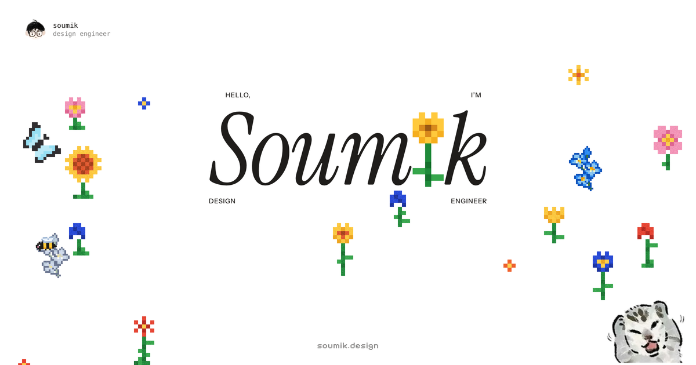
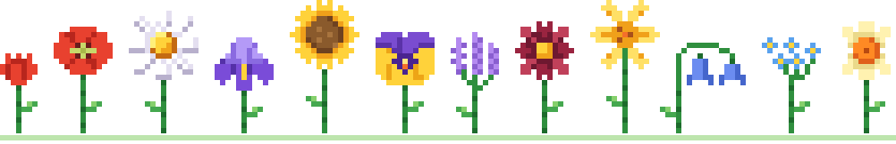

<div align="center">

<a href="https://soumik.design">
  
</a>

<br><br>

### soumik.design

the portfolio of Soumik Halder, a design engineer.<br>
a white page, a pixel garden, and some work underneath.

<br>

<a href="https://soumik.design"><kbd>&nbsp;visit the garden&nbsp;</kbd></a>
&nbsp;
<a href="#run-it-locally"><kbd>&nbsp;run it locally&nbsp;</kbd></a>
&nbsp;
<a href="#where-things-live"><kbd>&nbsp;poke around the code&nbsp;</kbd></a>

<br><br>



</div>

<br>

## what happens when you open it

Tap anywhere and a flower stitches itself in, one pixel at a time. A bee flies over to say hello. Plant a few more and butterflies turn up. Tap a flower that's already there and it turns into the next one of its kind: a ripple runs through it if the new one is the same size, and it fizzes into place if it's bigger or smaller. Everything plays a little music as you go.

Scroll down and the garden hands over to the work: WhyClub, and a reel of live shaders.

| | |
|---|---|
| The garden | Cross-stitch flowers on a canvas, drawn in stepped frames like real pixel art. More than a dozen flower families, each with a few colourways, and the garden picks whichever stands apart from its neighbours. |
| The bee and the butterflies | The bee visits flowers and talks. Butterflies arrive once the garden has grown, and keep out of the bee's way. |
| The sound | Synthesized live in D major pentatonic, so any mix of taps comes out sounding like music. |
| The work | WhyClub, with its screens shown as stories in a browser window and a link to the full case study, and a WebGL shader reel you can click through. |
| Case studies and the blog | Written in MDX at `/work/` and `/blog/`, in the same paper, ink and type as the garden. |
| The About card | Click about and the bee flies over and turns into the card. |

The garden also looks after itself. Past 40 flowers (24 on a phone) the oldest one unpicks over a few seconds, so there's always room to plant.

## how it's built

[Astro](https://astro.build) builds it into a plain static site. The home page is still hand-written HTML and CSS with vanilla JavaScript modules, no UI framework; Astro bundles the scripts and adds the case studies and the blog, written in MDX.

- The garden canvas stops drawing completely when nothing is moving.
- Every sound is generated with the Web Audio API. There are no audio files.
- The hand-off from the garden to the work is a CSS scroll-driven animation, so it runs off the main thread and costs no JavaScript.
- Nothing below the fold loads up front. The work section mounts as you scroll towards it, and its videos and WebGL reel wait until they're nearly on screen.
- Images ship as AVIF with WebP as the fallback.

## run it locally

Needs Node 22.23 or newer. From this folder:

```bash
npm install
```

```bash
npm run dev
```

Open http://localhost:4321. Edits to the scripts, pages and posts reload the page. `npm run build` makes the real site in `dist/`, and `npm run preview` serves that.

Anything only for your own machine (like the Agentation toolbar or the night prototype) loads behind `import.meta.env.DEV`, so it never reaches the live site. Load it with `import.meta.glob` rather than a plain `import()`: a file that isn't committed would break the build on Vercel, and glob just finds nothing.

Add `?garden=ink` to the address to see the old watercolour garden, which is still in the repo.

## where things live

```
src/
  pages/
    index.astro         the home page: markup, all its CSS, SEO and social tags
    work/, blog/        the index pages and the page every case study or post renders into
    sitemap.xml.ts      /sitemap.xml, built from every published page
  content/
    work/<slug>/        a case study: index.mdx plus its images
    blog/<slug>/        a post: index.mdx plus its images
  content.config.ts     what a case study's and a post's frontmatter must have
  components/
    Wordmark.astro      the Soumik wordmark with the pixel sunflower
    mdx/                Figure, Video and Screens, usable in any post without importing
  layouts/Base.astro    the head, masthead and footer of every page but home
  styles/site.css       the reading pages' styles
js/                     the home page's scripts, bundled by Astro as they are
  main.js               wires the page together (start here)
  content.js            copy and links: email, socials, project links, the bee's facts
  feel.js               sound design and haptics
  garden/
    pixels.js           the pixel garden: planting, growing, the self-clearing loop
    flora.js            flower and butterfly sprites, with their colourways
    bee.js              the bee
    butterflies.js      the butterflies
    watercolour.js      the old watercolour garden
  companions/
    about.js            the About card the bee morphs into
    mochi.js            mochi the cat (switched off for now)
  work/
    work.js             the work section
    slideshow.js        the WhyClub screens, as stories in a browser window
    reel.js             the live WebGL shader reel
public/                 served as is, at the same URLs as always
  assets/
    brand/              favicons, avatar, the link preview card
    fonts/              Faculty Glyphic, for the reel titles
    mochi/              mochi's art
    work/whyclub/       WhyClub screenshots and recordings
  robots.txt
assets/readme/          the flower strip at the top of this file (not deployed)
vercel.json             tells Vercel to build with Astro and serve dist/
```

`_drafts/` holds old prototypes. It's git-ignored and never deployed.

## write a case study or a post

1. Make a folder: `src/content/work/<slug>/` for a case study, `src/content/blog/<slug>/` for a post. The slug becomes the URL (`/work/<slug>/`, `/blog/<slug>/`).
2. Put an `index.mdx` in it, and its images next to it. Start from `src/content/work/whyclub/index.mdx` or `src/content/blog/a-garden-that-tends-itself/index.mdx`.
3. Fill in the frontmatter. `src/content.config.ts` lists the fields, and the build stops with a clear message if one is missing or wrong.
4. Set `draft: true` while you write. Drafts show in `npm run dev` and on Vercel preview deploys (every branch and PR gets one), and nowhere else, so a production build can never publish one by accident. `DRAFTS=1 npm run build` shows them in a local build. Remove it, or set it to `false`, to publish.

Markdown images (``) are optimised automatically. For more, these work in any post without importing:

- `<Figure src={shot} alt="…" caption="…" wide />`: an image from the folder, served as AVIF with a WebP fallback. Import it first: `import shot from './shot.png'`. `phone` keeps a phone screenshot narrow.
- `<Video src="/assets/…/clip.mp4" webm="…" poster="…" alt="…" caption="…" phone />`: a screen recording that plays, muted and looping, while it's on screen, with a button to pause it. With reduced motion, it waits for play.
- `<Screens device="phone" caption="…" />`: the WhyClub screens slideshow from the home page.

`wide` lets a figure run wider than the text, up to the cover's width. A published case study called `whyclub` also gets a "read the case study" link in the home page's work section.

## common edits

<details>
<summary>Which constant changes what</summary>

<br>

| To change | Edit |
|---|---|
| Email, socials, project links | `js/content.js` |
| What the bee says on the About card (keep each fact short, it sits in a small bubble) | `FACTS` in `js/content.js` |
| The About card text | `js/companions/about.js` |
| Work section copy | `js/work/work.js` |
| How full the garden gets before old flowers make room | `FULL` in `js/garden/pixels.js` |
| How big the flowers are (CSS px per pixel, phone and desktop) | `CELL` in `js/garden/pixels.js` |
| Which flowers grow, and how often | `KINDS` in `js/garden/pixels.js`. The sprites are in `js/garden/flora.js`. |
| How rare the showpieces are (sunflower, lily) | `SHOW` in `js/garden/pixels.js` |
| How far apart the same flower keeps from itself | `REACH`, `CLOSE`, `APART` and `MEMORY` in `js/garden/pixels.js` |
| What a tapped flower turns into | each family's `forms` in `js/garden/flora.js`. `RIPEN` sets how long growing takes and `TURNS` the two transitions and their lengths (ripple for a same-size head, scatter for a bigger or smaller one). |
| How many butterflies | `FLY_MAX` in `js/main.js` |
| Bring mochi back | set `MOCHI = true` in `js/main.js` |
| The link preview | the `og:` and `twitter:` tags in `src/pages/index.astro`, and `public/assets/brand/og-card.png` (1200×630) |

</details>

## sound

Planting walks a small melody on a kalimba-like tone. Tapping a flower to change it plays a quick music-box turn when it ripples, or a short bright fizz when it scatters. A growing flower plays a rising run, and its sparkles chime an octave up. Butterflies flutter off with a harp flick, and clearing the garden runs back down the scale.

The speaker button in the top right mutes it, and the page remembers your choice.

## accessibility and motion

- Every animation has a reduced-motion version. With reduced motion on, flowers appear without stitching, butterflies sit still and the scroll effects are off.
- Tap targets are at least 44px.
- The garden canvas is hidden from screen readers. The real content is plain HTML.

## deploy

The site is on Vercel, connected to this repo. A push to `main` builds and goes live at soumik.design within a minute or so. Other branches and PRs get preview deploys. `vercel.json` sets the build (`npm run build`, output `dist/`), so it doesn't depend on the dashboard settings. `.vercelignore` keeps this file, the drafts and the README art out of the upload.

<br>

<div align="center">

[soumik.design](https://soumik.design) &nbsp;·&nbsp; [x](https://x.com/soumikkhalder) &nbsp;·&nbsp; [linkedin](https://www.linkedin.com/in/soumik7/) &nbsp;·&nbsp; [email](mailto:soumikhalder026@gmail.com)

<sub>built by hand, one pixel at a time.</sub>

</div>
